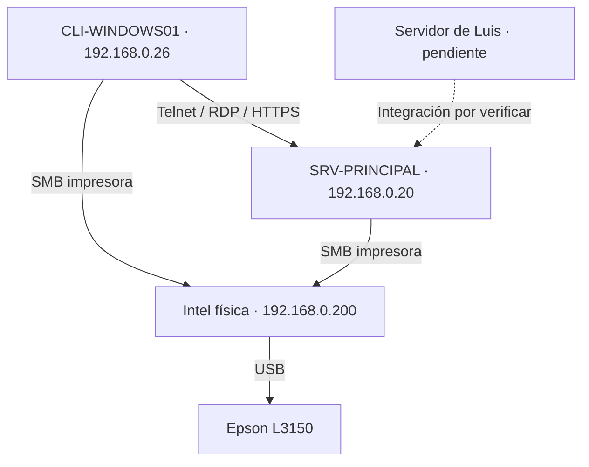

# Informe de implementación — Fase 2

[Índice](../README.md) · [Manual](02-manual.md) · [Pruebas](03-pruebas.md)

## Propósito y alcance

Continuar los servicios de fase 1 con acceso remoto, autenticación federada e impresión compartida. El alcance efectivamente probado corresponde al entorno de Mark. La falta de una actualización del servidor secundario impide acreditar Exchange, WAP y las pruebas integradas requeridas en el enunciado.

## Equipos y direcciones utilizadas

| Equipo | Función | Sistema / dirección documentada |
|---|---|---|
| Intel física, LAPTOP-6S06UVNR | HOST de las VM, USB Epson, carpetas de transferencia y Tailscale | Windows 11, 8 GB RAM; interfaz host-only 192.168.0.200/32 |
| SRV-PRINCIPAL | AD DS, DNS, DHCP, IIS, correo de fase 1, FTP, Telnet, RDP, RD Web y AD FS | Windows Server 2012 R2; 192.168.0.20/24; servidor1.com |
| CLI-WINDOWS01 | Pruebas del usuario y administración remota | Windows 10; DHCP 192.168.0.26 observado; unido a servidor1.com |
| HOST Ubuntu de Luis | Acceso al laboratorio mediante Tailscale | Sin actualización final de red recibida |
| SRV-SECUNDARIO | Destino propuesto de Exchange y WAP | Último dato previo: VM en NAT; configuración final e IP pendientes de confirmar |

El DHCP puede dar otra dirección al cliente; `.26` identifica la dirección observada, no una reserva acreditada. El HOST usa rutas /32 para alcanzar las VM y evitar que la red Wi-Fi superpuesta decida la interfaz equivocada. La ruta al cliente `.26` fue necesaria para el retorno de SMB.

## Implementación y decisiones

### Telnet

Se instaló el servicio nativo del servidor y el cliente de Windows. Se agregaron `usuario1` y `usuario2` al grupo `TelnetClients`, se configuró el dominio predeterminado y se permitió TCP 23 en la red de laboratorio. Una sesión real devolvió `SRV-PRINCIPAL` y `servidor1\usuario1`. La pertenencia de usuario2 está capturada; no se registró una sesión separada con esa cuenta.

### RDP y RD Web

Se habilitó RDP con NLA y acceso limitado a la red de laboratorio. Un bloqueo CredSSP del servidor antiguo se resolvió instalando KB4103725 y reiniciando. Se accedió como administrador desde el cliente.

Después se instaló RD Web Access sobre IIS. El portal por HTTPS permitió iniciar sesión, pero no tenía RemoteApps ni escritorios publicados. Para la opción clásica de conectar a un equipo se utilizó el modo Internet Explorer de Edge. Se acreditó una sesión RDP al principal por FQDN y se volvió a comprobar después de configurar AD FS. Esto no acredita todavía el requisito específico de acceder al servidor Exchange.

### Preparación de WAP mediante AD FS

El enunciado completo sí permite Web Application Proxy como alternativa a ISA/TMG. Se preparó AD FS en el principal: DNS `fs.servidor1.com`, certificado autofirmado con clave privada, cuenta `svc_adfs` y granja con Windows Internal Database. La instalación terminó en Success, el servicio quedó Running y una prueba desde el cliente mostró “Ha iniciado sesión”.

AD FS y WAP son componentes distintos. El primero está verificado; el segundo no tiene instalación ni publicación de aplicaciones acreditadas. El puerto 8080 y el mensaje literal de autenticación tampoco se validaron. La posibilidad de alojar WAP junto con Exchange en el secundario requiere revisar capacidad, bindings HTTPS y nombres antes de ejecutarse; es una propuesta, no una topología validada.

### Impresión compartida

La Epson L3150 quedó conectada por USB a la Intel que virtualiza el servidor web y compartida como `impresora`. Se usó la cuenta local `ImpresionLab` para autenticar el acceso desde las VM. En el cliente Windows, la instalación previa del controlador permitió imprimir. En el principal, luego de instalar el driver persistió el error 0x8007011b al agregar la conexión compartida. La solución que funcionó fue crear un puerto local UNC y una cola local `Epson-Red` con el driver Epson.

Mark confirmó la salida física de ambas páginas de prueba. La captura del cliente muestra el trabajo en cola; la del servidor muestra su cola Normal. No se dispone de fotografía de las hojas. Falta ejecutar esta prueba desde Exchange, que es el origen solicitado en el proyecto.

## Conclusión del alcance

La documentación entrega las configuraciones y evidencias disponibles del entorno principal. No se asigna un porcentaje de cumplimiento global: el enunciado exige al menos 80 % por fase y una integración que todavía no está demostrada. Exchange, WAP, OWA, impresión desde Exchange y el acceso RDP a ese destino siguen en la lista de cierre. También continúa sin acreditarse aquí la unión del cliente Linux al dominio y sus dos funcionalidades.
