# Evidencias de fase 2

68 capturas originales agrupadas por servicio. Se incluyen resultados correctos y errores resueltos. Las pruebas físicas confirmadas en la conversación se identifican aparte: una cola de impresión no demuestra por sí sola que salió papel.

[Volver a fase 2](../README.md) · [Matriz de pruebas](../docs/03-pruebas.md) · [Manifest con SHA-256](manifest.json)

## Telnet

### E01 — Inventario inicial de roles, servicios y red

**Estado:** Diagnóstico inicial. Original: `image(20261027-023059).png`.

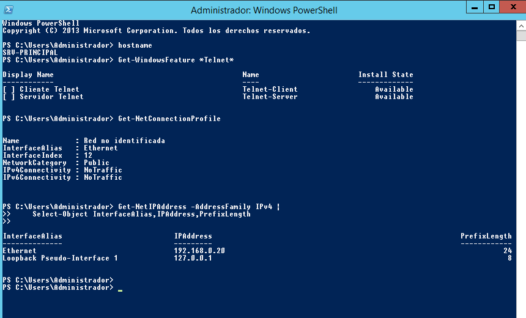

### E02 — Instalación y estado del servicio Telnet

**Estado:** Configuración. Original: `image(20261027-023435).png`.

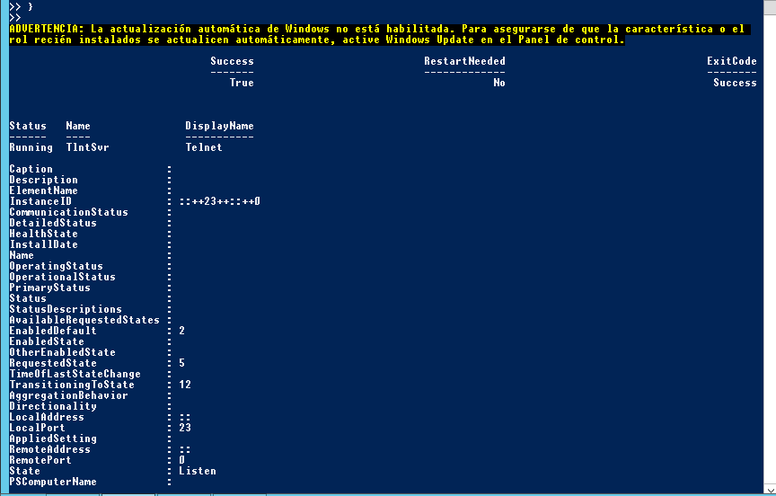

### E03 — Consulta del dominio y perfil de red

**Estado:** Diagnóstico. Original: `image(20261027-023513).png`.

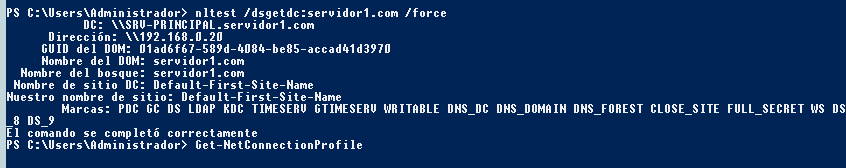

### E04 — Grupo TelnetClients y parámetros del servidor Telnet

**Estado:** Configuración. Original: `image(20261027-024036).png`.

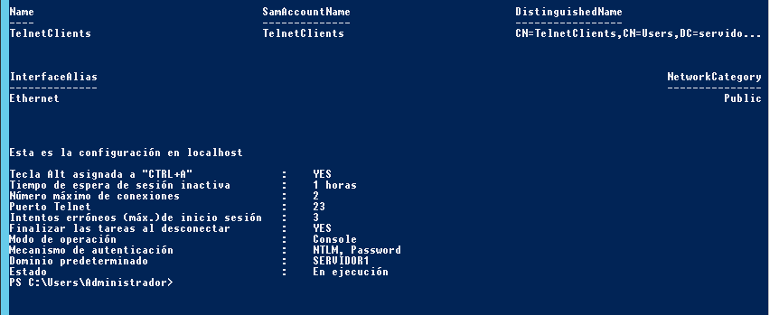

### E06 — Prueba TCP 23 inicialmente fallida desde el cliente

**Estado:** Incidencia. Original: `image(20261027-025121).png`.

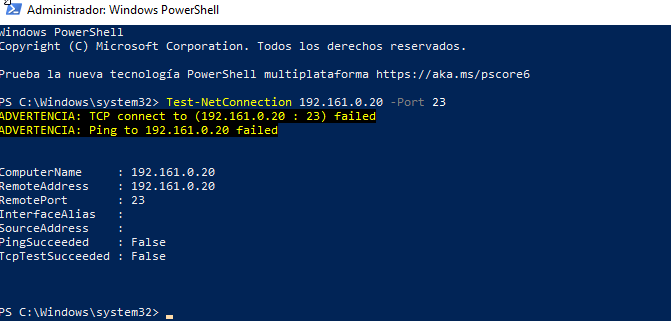

### E07 — Prueba TCP 23 satisfactoria desde el cliente

**Estado:** Verificado en captura. Original: `image(20261027-025457).png`.

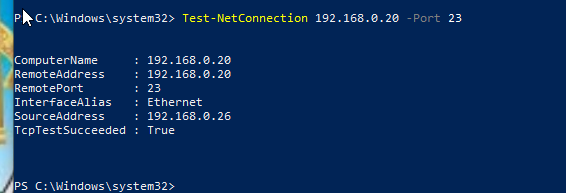

### E08 — usuario1 y usuario2 agregados a TelnetClients

**Estado:** Verificado en captura. Original: `image(20261027-025655).png`.

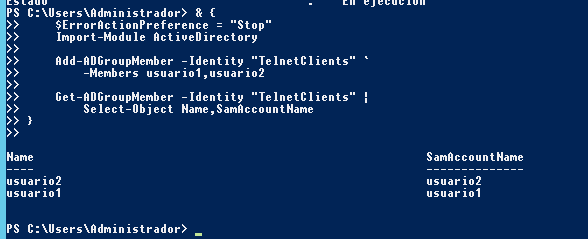

### E09 — Instalación de Telnet Client en Windows

**Estado:** Configuración. Original: `image(20261027-045235).png`.

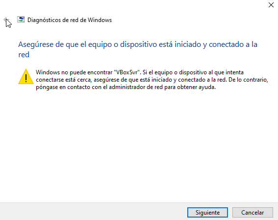

### E10 — Cliente Telnet no disponible antes de completar su instalación

**Estado:** Incidencia. Original: `image(20261027-045722).png`.

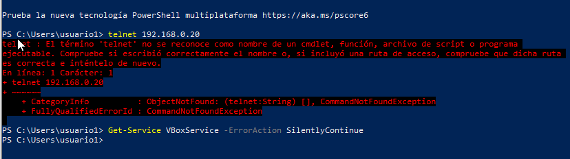

### E11 — Sesión Telnet: SRV-PRINCIPAL y servidor1\usuario1

**Estado:** Prueba funcional. Original: `image(20261027-050210).png`.

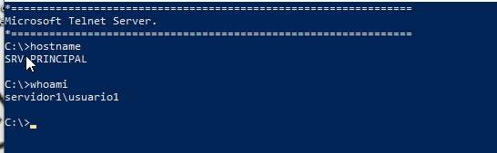

## RDP y RD Web

### E12 — Inventario previo: roles de acceso remoto y federación disponibles

**Estado:** Diagnóstico inicial. Original: `image(20261027-050724).png`.

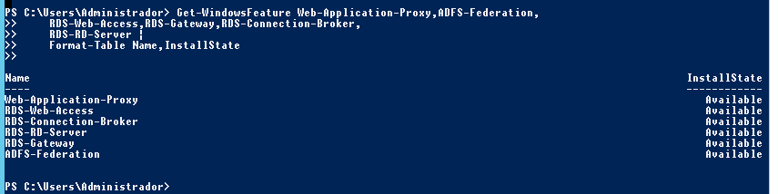

### E30 — RDP inicialmente deshabilitado y TermService detenido

**Estado:** Diagnóstico inicial. Original: `image(20261027-230849).png`.

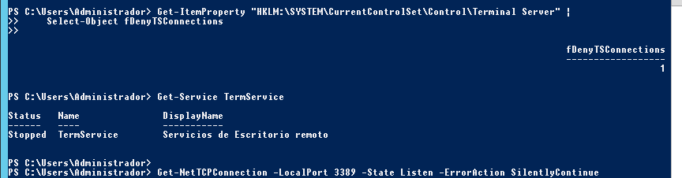

### E31 — Error de autenticación CredSSP en el acceso RDP

**Estado:** Incidencia. Original: `image(20261027-231433).png`.

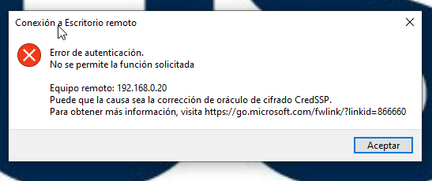

### E32 — Escritorio de SRV-PRINCIPAL abierto desde el cliente

**Estado:** Prueba funcional. Original: `image(20261027-232905).png`.

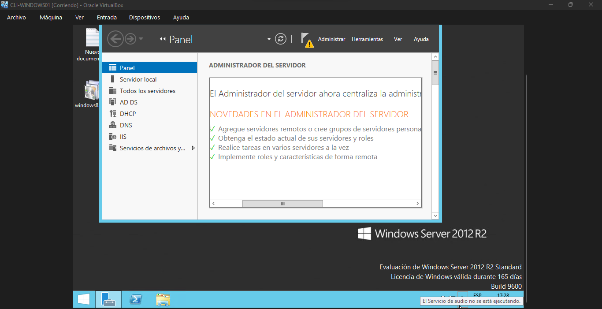

### E33 — Identidad del servidor y sesión RDP-Tcp#1 como administrador

**Estado:** Prueba funcional. Original: `image(20261027-233143).png`.

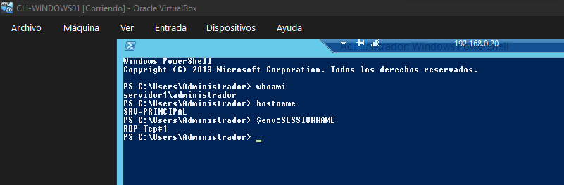

### E34 — Instalación del rol RD Web Access satisfactoria

**Estado:** Configuración. Original: `image(20261028-000158).png`.

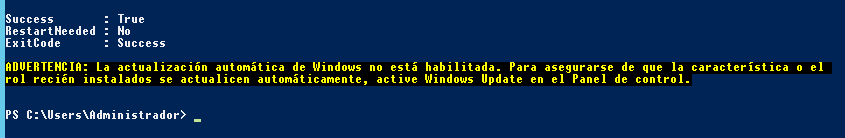

### E35 — Enlaces IIS y certificado existente antes de AD FS

**Estado:** Diagnóstico. Original: `image(20261028-000321).png`.

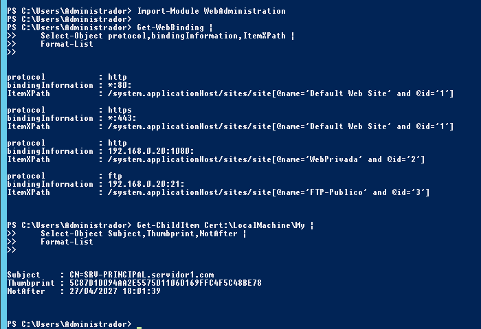

### E36 — Regla Practicas-RDWeb-HTTPS habilitada en TCP 443

**Estado:** Configuración. Original: `image(20261028-000433).png`.

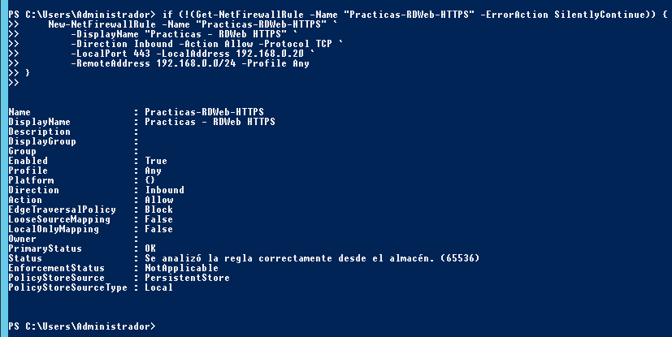

### E37 — Formulario de acceso de RD Web por nombre de dominio

**Estado:** Prueba funcional. Original: `image(20261028-000652).png`.

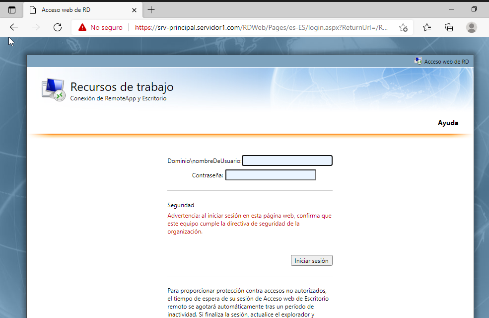

### E38 — Sesión iniciada en el portal sin RemoteApps publicadas

**Estado:** Prueba funcional. Original: `image(20261028-000946).png`.

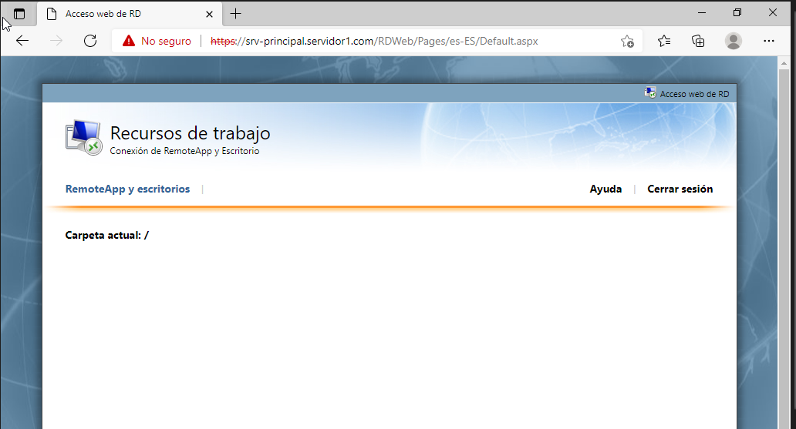

### E39 — Portal vacío antes de utilizar Conectarse a un equipo remoto

**Estado:** Diagnóstico. Original: `image(20261028-001452).png`.

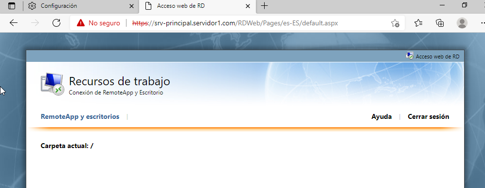

### E40 — Conexión al FQDN; SESSIONNAME mostraba Console en PowerShell

**Estado:** Diagnóstico de sesión. Original: `image(20261028-001900).png`.

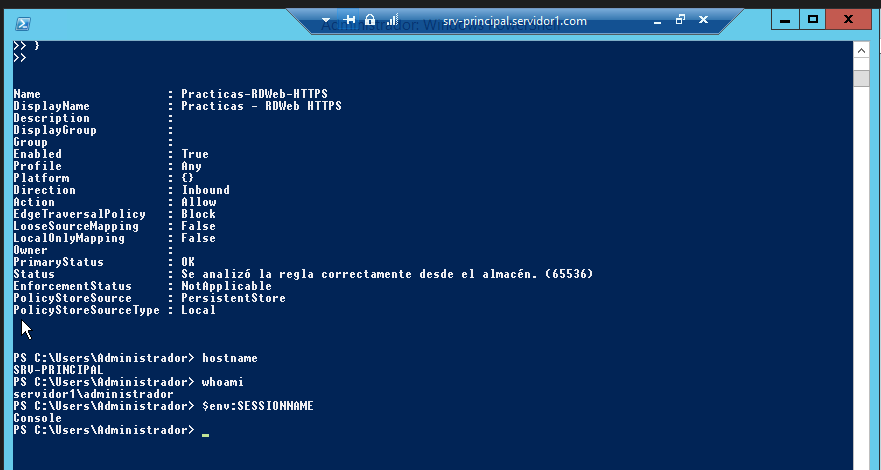

### E41 — query session confirma rdp-tcp#2 Administrador activo

**Estado:** Prueba funcional. Original: `image(20261028-002606).png`.

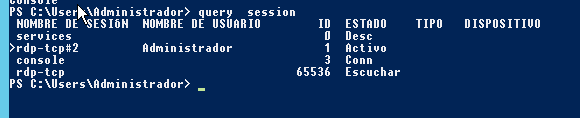

### E52 — Inicio de sesión RD Web satisfactorio después de configurar AD FS

**Estado:** Prueba de coexistencia. Original: `image(20261028-021952).png`.

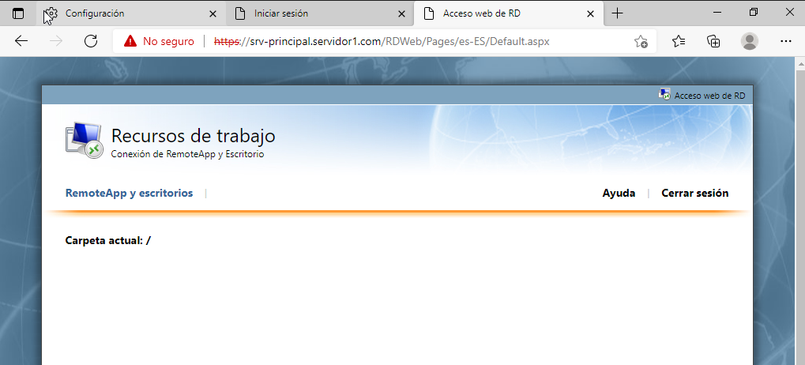

### E53 — Después de AD FS: SRV-PRINCIPAL y rdp-tcp#3 Administrador activo

**Estado:** Prueba funcional. Original: `image(20261028-022332).png`.

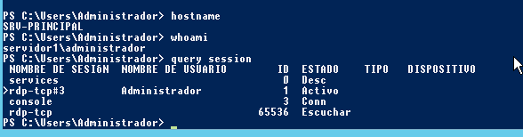

## AD FS: preparación de WAP

### E43 — Rol AD FS instalado; configuración todavía pendiente en ese momento

**Estado:** Configuración. Original: `image(20261028-011754).png`.

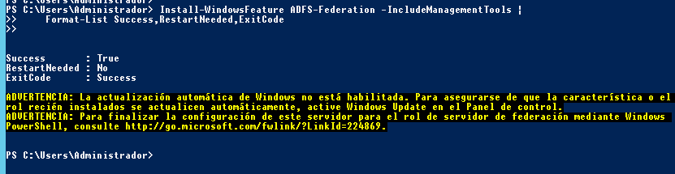

### E44 — Enlace TLS existente de IIS y adfssrv detenido antes de configurar

**Estado:** Diagnóstico inicial. Original: `image(20261028-011953).png`.

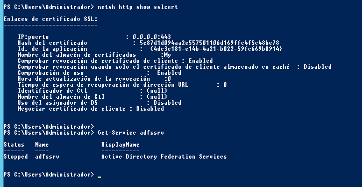

### E45 — fs.servidor1.com resuelve a 192.168.0.20 y sintaxis local de certificados

**Estado:** Verificado en captura. Original: `image(20261028-012523).png`.

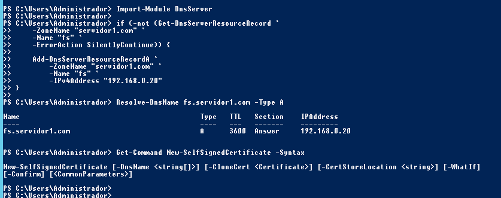

### E46 — Certificado fs.servidor1.com creado con clave privada

**Estado:** Verificado en captura. Original: `image(20261028-012741).png`.

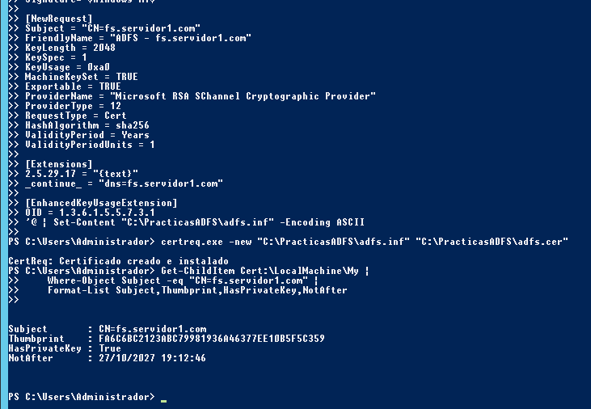

### E47 — Importación de confianza y comprobaciones previas de AD FS

**Estado:** Configuración; salida parcial. Original: `image(20261028-014553).png`.

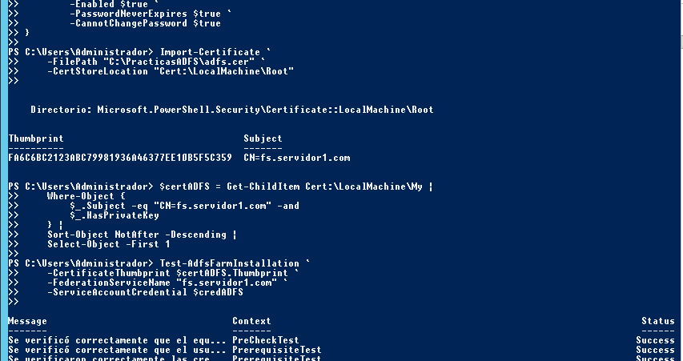

### E48 — Granja AD FS creada, servicio Running y HTTPS 443

**Estado:** Prueba de configuración. Original: `image(20261028-014817).png`.

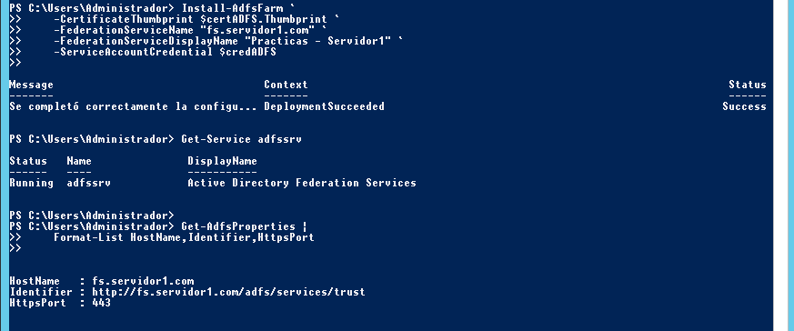

### E49 — Página de AD FS muestra Ha iniciado sesión

**Estado:** Prueba funcional. Original: `image(20261028-015301).png`.

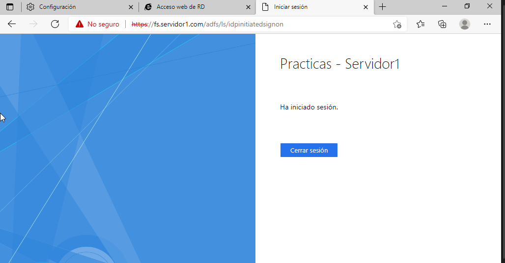

### E50 — Exportación PFX fallida al omitir el nombre del comando

**Estado:** Incidencia. Original: `image(20261028-021524).png`.

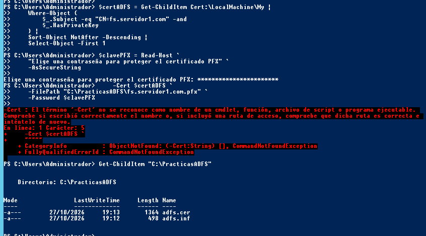

### E51 — Archivo PFX exportado de 2923 bytes; solo se muestra su listado

**Estado:** Verificado en captura. Original: `image(20261028-021736).png`.

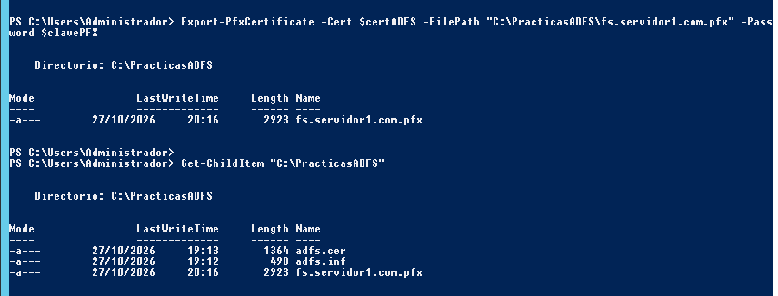

## Impresora Epson

### E13 — Epson compartida como impresora en el HOST 192.168.0.200

**Estado:** Verificado en captura. Original: `image(20261027-055654).png`.

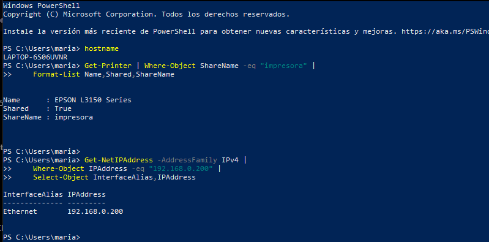

### E14 — Intento inicial de conexión desde Windows Server fallido

**Estado:** Incidencia. Original: `image(20261027-060502).png`.

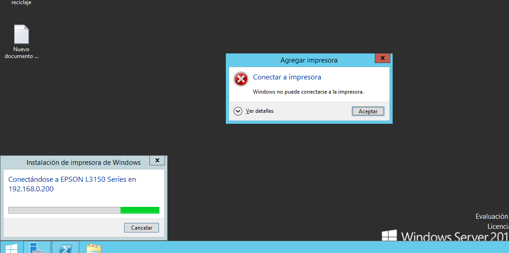

### E15 — Error inicial 0x0000011b al conectar la impresora

**Estado:** Incidencia. Original: `image(20261027-060602).png`.

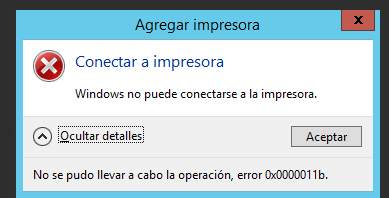

### E17 — Spooler activo e inventario de actualizaciones sin ordenar InstalledOn

**Estado:** Diagnóstico. Original: `image(20261027-061111).png`.

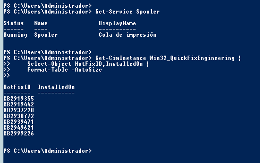

### E18 — Error de ruta de red 0x80070035 al acceder a impresora

**Estado:** Incidencia. Original: `image(20261027-061144).png`.

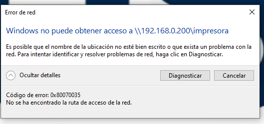

### E19 — Segundo intento de acceso al recurso impresora sin ruta disponible

**Estado:** Incidencia. Original: `image(20261027-061512).png`.

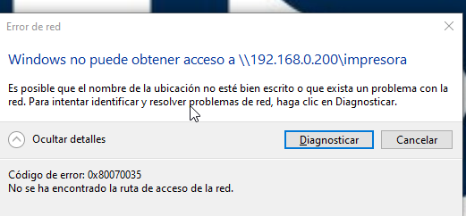

### E20 — TCP 445 fallido desde CLI-WINDOWS01

**Estado:** Incidencia. Original: `image(20261027-061750).png`.

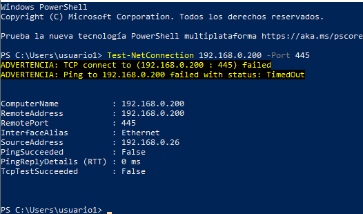

### E21 — TCP 445 satisfactorio desde CLI-WINDOWS01

**Estado:** Verificado en captura. Original: `image(20261027-062004).png`.

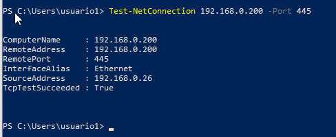

### E22 — Solicitud de elevación para instalar controladores

**Estado:** Configuración. Original: `image(20261027-062410).png`.

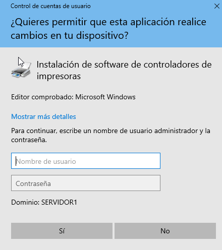

### E23 — Acceso denegado durante la búsqueda del controlador

**Estado:** Incidencia. Original: `image(20261027-062750).png`.

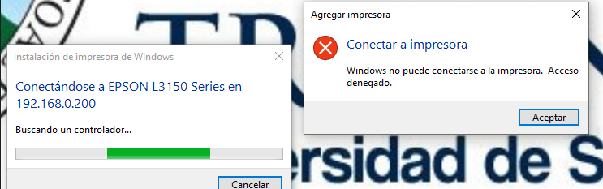

### E24 — Error 1219 por sesiones con credenciales diferentes

**Estado:** Incidencia. Original: `image(20261027-063514).png`.

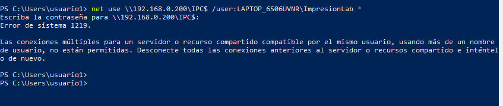

### E25 — Inventario de la conexión SMB existente a impresora

**Estado:** Diagnóstico. Original: `image(20261027-063603).png`.

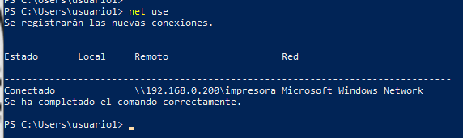

### E26 — Retiro de conexión anterior y autenticación IPC$ satisfactoria

**Estado:** Verificado en captura. Original: `image(20261027-063822).png`.

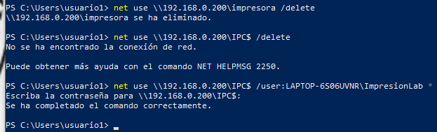

### E27 — Acceso denegado aun después de autenticar SMB

**Estado:** Incidencia. Original: `image(20261027-064053).png`.

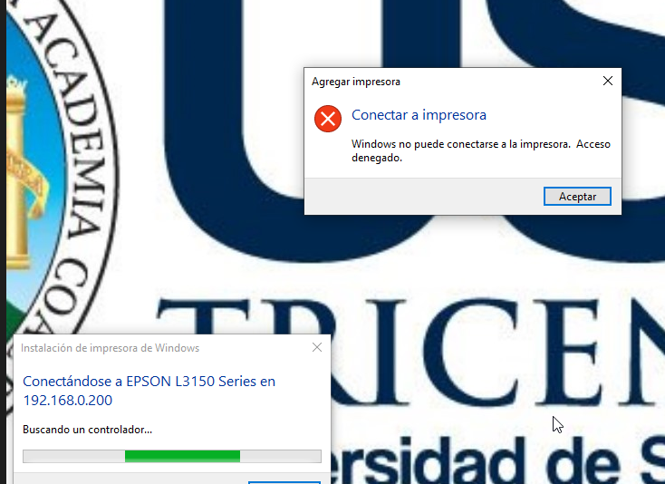

### E28 — Controlador Epson agregado al cliente como oem2.inf

**Estado:** Verificado en captura. Original: `image(20261027-065259).png`.

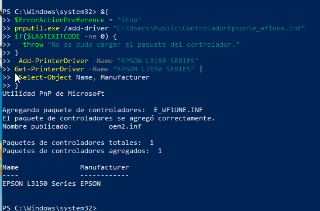

### E29 — Propiedades Epson y página de prueba en cola desde el cliente

**Estado:** Cola visible; impresión confirmada por el usuario. Original: `image(20261027-065458).png`.

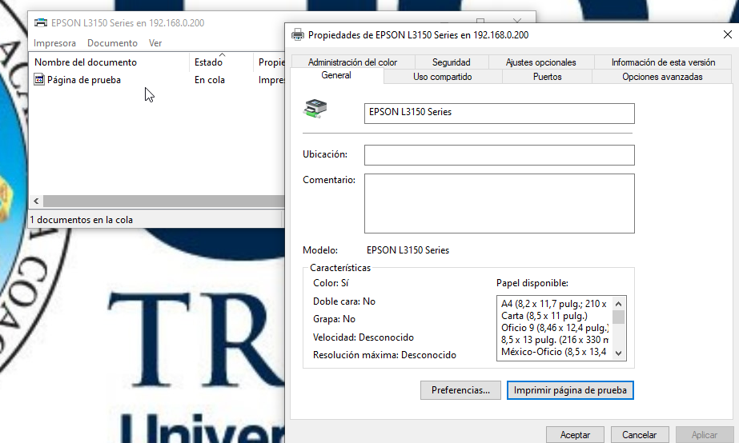

### E64 — Servidor sin Epson instalada y TCP 445 al HOST satisfactorio

**Estado:** Diagnóstico inicial. Original: `image(20261028-032236).png`.

### E65 — Paquete Epson agregado a Windows Server como oem4.inf

**Estado:** Verificado en captura. Original: `image(20261028-042356).png`.

### E66 — Driver registrado; conexión compartida falla con 0x80070040

**Estado:** Incidencia. Original: `image(20261028-042812).png`.

### E67 — IPC$ autenticado; Add-Printer falla con 0x8007011b

**Estado:** Incidencia. Original: `image(20261028-043018).png`.

### E68 — Epson-Red creada con puerto UNC y estado Normal

**Estado:** Configuración funcional; impresión confirmada por el usuario. Original: `image(20261028-044029).png`.

## Incidencias y capacidad

### E05 — Acceso inicial fallido a la carpeta de VirtualBox desde el cliente

**Estado:** Incidencia. Original: `image(20261027-024501).png`.

### E16 — Get-HotFix: error al ordenar la propiedad InstalledOn

**Estado:** Incidencia. Original: `image(20261027-060812).png`.

### E42 — Recursos limitados de la Intel: memoria y disco disponibles

**Estado:** Diagnóstico de capacidad. Original: `image(20261028-010337).png`.

### E54 — Copia al HOST bloqueada por carpeta VirtualBox de solo lectura

**Estado:** Incidencia. Original: `image(20261028-023637).png`.

### E55 — Error de parámetro o ruta durante la copia por VBoxSvr

**Estado:** Incidencia. Original: `image(20261028-024041).png`.

### E56 — VBoxSvr devuelve 0x80070043, nombre de red no encontrado

**Estado:** Incidencia. Original: `image(20261028-024817).png`.

### E57 — Configuración de la carpeta compartida TransferenciaPracticas

**Estado:** Diagnóstico. Original: `image(20261028-025124).png`.

### E58 — Acceso a carpeta compartida aún fallido

**Estado:** Incidencia. Original: `image(20261028-025516).png`.

### E59 — VBoxService activo; reinicio ejecutado después de corregir comando

**Estado:** Diagnóstico. Original: `image(20261028-025536).png`.

### E60 — Acceso todavía fallido tras reiniciar el servidor

**Estado:** Incidencia. Original: `image(20261028-025804).png`.

### E61 — VBoxSF cargado; VBoxControl no estaba en la ruta supuesta

**Estado:** Diagnóstico. Original: `image(20261028-030639).png`.

### E62 — VBoxService localizado en System32; consola esperando continuación

**Estado:** Diagnóstico. Original: `image(20261028-031325).png`.

### E63 — VBoxControl 7.2.20 informa Shared Folder mappings (0)

**Estado:** Causa identificada. Original: `image(20261028-031556).png`.

